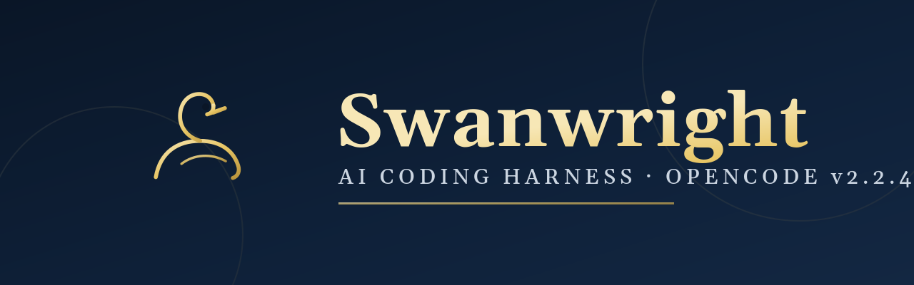
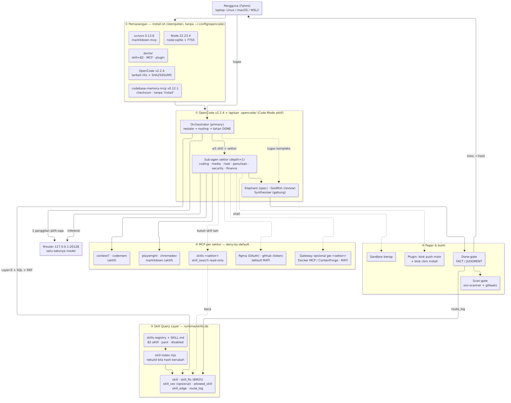
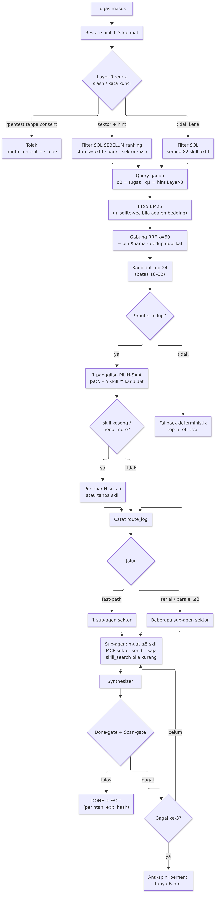
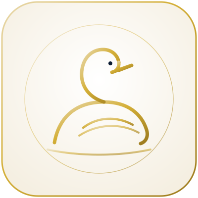

<p align="center">
  
</p>

<p align="center">
  <em>Elegant AI coding harness — OpenCode v2.2.4 · 9router · skill query yang ramping</em>
</p>

<p align="center">
  <a href="https://github.com/fahmi0812/Swanwright/releases/tag/v0.1.6"></a>
  <a href="https://github.com/anomalyco/opencode/releases/tag/v2.2.4"></a>
  
  
  <a href="LICENSE"></a>
</p>

---

## Instalasi satu baris

```bash
curl -fsSL https://raw.githubusercontent.com/fahmi0812/Swanwright/main/install.sh | bash
```

Alternatif (clone penuh):

```bash
git clone https://github.com/fahmi0812/Swanwright.git && cd Swanwright && ./install.sh
```

Lalu:

```bash
source ~/.swanwright/env.sh
bash ~/.swanwright/src/install.sh --doctor   # atau: bash install.sh --doctor di dalam clone
```

Installer **idempoten**, mem-pin SHA256 + mencocokkan file checksum rilis untuk OpenCode, Node, codebase-memory-mcp, dan uv. Tidak menyentuh `~/.config/opencode`. Token hanya lewat `~/.swanwright/secrets.env` (`chmod 600`).

> **Jangan** jalankan `codebase-memory-mcp install` / `update` — binary didaftarkan manual sebagai MCP `codemem`.

---

## Fitur

| | |
|---|---|
| **Orchestrator tipis** | Primary agent → sub-agen sektor (depth=1) → Elephant / Goldfish / Synthesizer |
| **82 skill aktif** | Lazy-load; `api-security` & `llm-security` tetap disabled |
| **Skill Query Layer** | SQLite FTS5 BM25 (+sqlite-vec opsional), filter SQL keras, RRF, 1 panggilan 9router pilih ≤5 |
| **MCP per sektor** | deny-by-default `*_*` → allow server sektor sendiri; `skills-<sektor>` read-only |
| **Plugin guard** | Blok push ke `main`/`master` + blok `codebase-memory-mcp install/update` |
| **Done-gate berbukti** | FACT / JUDGMENT; osv-scanner + gitleaks opsional |
| **Doctor** | `scripts/doctor.sh` — verifikasi end-to-end 0 FAIL |

---

## Arsitektur

<p align="center">
  
</p>

<p align="center">
  
</p>

Rincian: [`ARCHITECTURE.md`](ARCHITECTURE.md) · [`docs/ROUTING.md`](docs/ROUTING.md) · [`docs/MCP.md`](docs/MCP.md)

---

## Sektor & MCP

| Sektor | Server (selain `skills-<sektor>`) |
|---|---|
| **coding** | context7 · codemem · playwright · chromedev · github *(mati)* |
| **media** | playwright · chromedev · figma *(mati, OAuth)* |
| **riset** | context7 · markitdown · playwright |
| **penulisan** | context7 · markitdown |
| **security** | context7 · codemem *(defensif; tanpa trading/Kali)* |
| **finance** | markitdown *(tanpa trading MCP)* |
| elephant / goldfish | context7+codemem / codemem |
| orchestrator / synthesizer | — |

Gateway `gw-*`, figma, github: **disabled by default**. Lihat [`docs/MCP-GATEWAY.md`](docs/MCP-GATEWAY.md).

---

## Isi paket

```
Swanwright/
├── install.sh              # one-liner & local install (SHA256 terpin)
├── opencode.jsonc          # OpenCode v2.2.4 + MCP sektor
├── .opencode/              # agents (10) · skills (82) · plugins · rules
├── router/                 # skill-db FTS5, layer0, layer1-select, mcp-sectors
├── harness/                # done-gate, scan-gate, sandbox
├── scripts/doctor.sh       # verifikasi 0 FAIL
├── packs/                  # pack opsional (mati default)
├── docs/                   # PRD, MCP, routing, catalog
└── assets/                 # logo, banner, diagram
```

---

## Verifikasi

```bash
source ~/.swanwright/env.sh
bash install.sh --doctor     # harap: doctor: 0 FAIL
npm test                     # harap: 83/83
npm run validate
npm run skills:metrics
```

**Metrik retrieval (BM25-only, golden 154, diukur 31 Okt 2026):**

| Metrik | Nilai |
|---|---|
| tests | **83 / 83** |
| top-1 | **0,78** |
| recall@5 (any) | **0,92** |
| MRR | **0,84** |
| Layer-0 mismatch | **0** |

---

## Persyaratan

| | |
|---|---|
| OS | Linux · macOS · **WSL2** (Windows native ditolak) |
| Runtime | Node ≥ 22.6 (dipasang otomatis bila perlu) · OpenCode **v2.2.4** |
| Model | **9router** di `127.0.0.1:20128` (`SW_9ROUTER_URL` / `SW_9ROUTER_KEY`) |
| Browser | Google Chrome stable untuk `chrome-devtools-mcp` |
| Opsional | `osv-scanner` v2.7.0 · `gitleaks` v8.30.1 · `sqlite3` CLI · Docker (gateway) |

Selalu `source ~/.swanwright/env.sh` sebelum menjalankan `opencode`.

---

## Batasan yang diketahui (jujur)

- Seleksi Layer-1 lewat 9router **belum diuji live** di semua lingkungan (fallback deterministik top-5 bila 9router mati).
- MCP **gateway / figma / github** untested end-to-end (mati default).
- Routing miss: prompt *"cek CVE dependency"* tanpa hit Layer-0 belum menemukan `security-audit` (lihat miss di `runtime/metrics.json`).
- Angka retrieval di atas adalah BM25-only pada golden berulang — jangan dibaca sebagai klaim produksi absolut.

---

## Lisensi

Kode Swanwright: **MIT** — lihat [`LICENSE`](LICENSE).  
Skill pihak ketiga: [`NOTICE.md`](NOTICE.md) · [`docs/SKILLS-CATALOG.md`](docs/SKILLS-CATALOG.md).

<p align="center">
  
  <br/>
  <sub>Swanwright · v0.1.6</sub>
</p>
